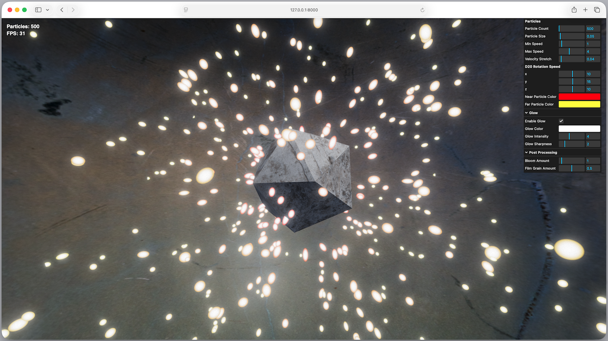
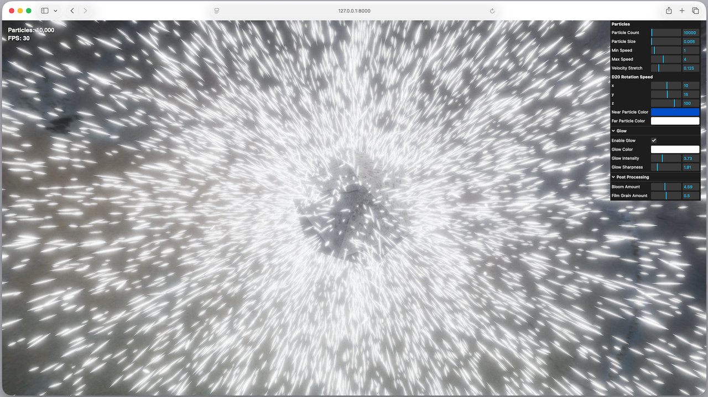

# Three.js GPU Particles

A particle simulation in Three.js using WebGPU compute shaders. Particles bounce off a rotating D20 object and respawn on an outer sphere.





## Features

- GPU particle simulation and collisions with the D20 object.
- GPU initialization with random positions and velocities on startup and particle-count changes.
- Automatic respawning on the outer sphere when a particle reaches it moving outward.
- Camera-facing particle billboards with velocity-based stretching.
- Particle colors based on distance to the D20 object's surface.
- Adjustable particle glow, bloom, and film grain.
- On-screen particle count and FPS.

## Requirements

- A WebGPU-enabled browser and a compatible GPU.
- **Three.js 0.187.0**, loaded automatically by the browser.
- A static web server on localhost or a site served over HTTPS.

## Run the demo

1. Open a terminal in the project folder.
2. Run the following Python command to start a local web server.

   ```sh
   python3 -m http.server 8000 --bind 127.0.0.1
   ```

3. Open [localhost:8000](http://localhost:8000) in a WebGPU-enabled browser.

The scene starts with **500 particles**. Adjust the controls in the **Particles** panel in the top-right corner. Runtime changes are temporary. The D20 object rotates automatically.

## Settings

| Setting | Description |
| --- | --- |
| Particle Count | Number of particles, from 1 to 1,000,000. |
| Particle Size | Size of the particle billboards. |
| Min Speed / Max Speed | Range of initial particle speeds. |
| Velocity Stretch | Stretch the billboards along their movement direction in camera space. |
| D20 Rotation Speed | Rotation speed around each world axis, in degrees per second. |
| Near Particle Color / Far Particle Color | Colors used near and far from the D20 object's surface. |
| Enable Glow / Glow Color / Glow Intensity / Glow Sharpness | Control the glow within each particle. |
| Bloom Amount / Film Grain Amount | Control the post-processing effects. |

Changing Particle Count recreates the GPU particle buffers and restarts the particles.

## Source files

| File | Purpose |
| --- | --- |
| [particle_controller.js](scripts/particle_controller.js) | Scene, particle settings, GPU buffers, D20 collision planes, compute dispatch, particle rendering, and particle count and FPS display. |
| [particle_compute.js](shaders/particle_compute.js) | Initializes particles, updates their positions, respawns them at the outer sphere, and resolves D20 collisions on the GPU. |
| [particle_render.js](shaders/particle_render.js) | Creates particle billboards and applies stretching, surface-distance colors, glow, and soft circular edges. |
| [film_grain.js](shaders/film_grain.js) | Applies screen-space film grain that changes each frame, with reduced strength in brighter pixels. |
| [index.html](index.html) | Demo page, HUD, styles, and Three.js module imports. |

Particle positions and velocities are stored in GPU buffers and used as instance attributes when drawing the billboards. The D20 mesh faces are converted to local-space planes at startup and uploaded to a read-only buffer shared by the compute and vertex shaders.
